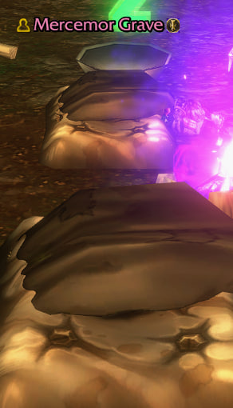
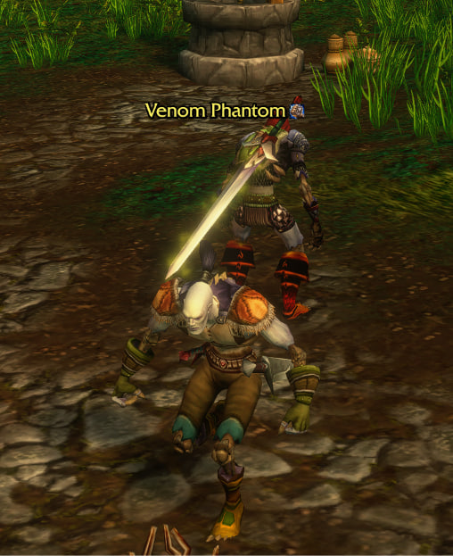
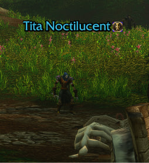

# ForeverAlly

You run through a busy town, and half the people around you could use your buff. Which half? And that warrior by the mailbox: didn't you tank a dungeon together last week?

**ForeverAlly** answers both, right on the nameplates of the players around you. It is built and tested for **WoW: Forever**.

  
  
  

## Recent allies

Anyone you've been in a group with gets a small icon by their name and a line in their tooltip: "Grouped with you before". The game's own Recent Allies list misses some people (friends, for example), so ForeverAlly keeps its own memory. You can also mark or unmark your target by hand with `/ally add` and `/ally del`.

## Missing buffs

Out of combat, next to each friendly player's name you see the icon of every one of *your* class buffs they don't have.

- **Priest:** Fortitude, Divine Spirit
- **Druid:** Mark of the Wild
- **Mage:** Arcane Intellect
- **Paladin:** the best blessing that player can still get
- **Optional, off by default:** Shadow Protection, Thorns (tanks only or everyone), Unending Breath, Detect Invisibility

A buff with less than 30% of its time left counts as missing, so you can renew it early. The threshold is adjustable.

## One-key auto buff

Press a key, and the next player who needs a buff gets it: you first, then your group, then everyone around. It is one cast per key press, out of combat only. You press the key every time, so it is not a bot.

- **Right rank for the level.** Forever doesn't pick the rank by itself, so the addon does, and low-level players don't get "target too low level".
- **Smart blessings.** For paladins it picks the best blessing each player can still get and takes other paladins' blessings into account. You set the order separately for mana users and for rage and energy users. Tanks get no Salvation by default.
- **Never stuck.** Someone out of sight goes to the back of the queue for a few seconds.

## Install

- **CurseForge:** [ForeverAlly](https://www.curseforge.com/wow/addons/foreverally), or search for ForeverAlly in the CurseForge app.
- **By hand:** download the zip from [Releases](../../releases), unpack it into `World of Warcraft\_forever_\Interface\AddOns` so that the folder is called `ForeverAlly`.

## Getting started

1. Turn on friendly player nameplates. If they are off, the addon tells you and can switch them on.
2. Set your auto-buff key in `/fally`, or in Key Bindings > AddOns > ForeverAlly.
3. Walk into a crowd and press it.

Every part can be turned off on the options page. There you also choose icon sizes, which buffs to track and who to buff: yourself, your group or everyone.

## Works with

- No UI addons at all.
- UI suites that keep Blizzard's nameplates, such as EllesmereUI.
- Nameplate replacements like Plater: the icons sit above the plate.

## Commands

- `/fally`: options
- `/fally status`: what the addon thinks of your target, and what the next key press will cast
- `/fally log on|off|show|clear`: troubleshooting log
- `/ally add`, `/ally del`: mark or unmark a recent ally

## Languages

English, Русский, Deutsch, Français, Español, Português (Brasil), Italiano. Spell names come from the game in your client's language. Translation fixes are welcome: open an issue or a pull request against `Locales.lua`.

## Notes for developers

The Forever client behaves differently from retail and Classic in several places (friendly nameplates, `/targetexact`, ranks, aura sources). [CHANGELOG.md](CHANGELOG.md) lists what was found and how the addon works around it.

## License

MIT, see [LICENSE](LICENSE).

---

## По-русски

Бежишь через город, вокруг толпа, и половине не помешал бы твой бафф. Только кому именно? А вон тот воин у почты: не с ним ли ты на прошлой неделе ходил в подземелье?

**ForeverAlly** показывает это прямо на табличках игроков. Сделан и проверен на **WoW: Forever**.

- **Недавние союзники.** У тех, с кем ты был в группе, рядом с именем значок, а в подсказке строка «Были в одной группе». Игровой список недавних союзников пропускает людей, например друзей, поэтому аддон помнит их сам. Отметить цель вручную: `/ally add`, снять отметку: `/ally del`.
- **Кому чего не хватает.** Вне боя возле имени дружественного игрока видны значки твоих классовых баффов, которых у него нет. Жрец, друид, маг и паладин. Бафф, у которого осталось меньше 30% времени, тоже считается недостающим.
- **Автобафф одной клавишей.** Каждое нажатие баффает следующего, кому нужно: сначала тебя, потом группу, потом всех вокруг. Одно нажатие, одно заклинание, только вне боя. Это не бот. Ранг подбирается по уровню цели, а паладин вешает каждому лучшее благословение из тех, что игрок ещё может получить, с учётом других паладинов.

**С чего начать:** включи таблички дружественных игроков (аддон подскажет) и назначь клавишу в `/fally`.

Работает без других аддонов и с интерфейсами на стандартных табличках (EllesmereUI). С Plater значки стоят над табличкой. Все настройки на русском.
